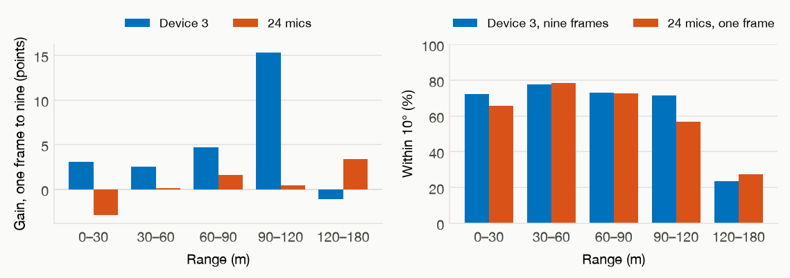
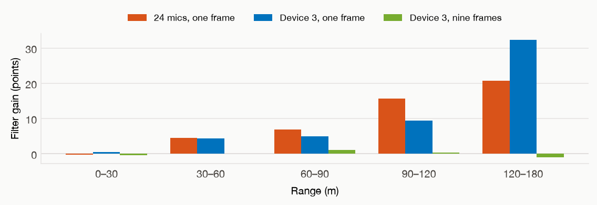
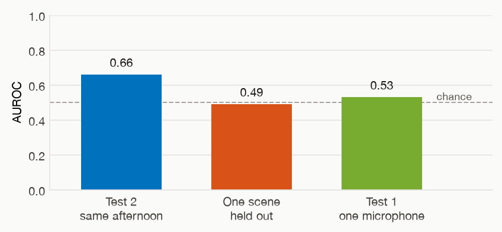

**Project Category:** Applied: Audio / Convolutional Networks / Defense & Security.

**Code:** [github.com/danmasad/Acoustic-Drone-Detection](https://github.com/danmasad/Acoustic-Drone-Detection)

## 1. Motivation and problem definition

Drones are small, quiet targets that often fly without a radio link, which defeats cameras in poor visibility and radio detectors outright. Sound is a cheap fallback: rotors are loud and harmonically distinctive. From a ground array we want a report, whether a drone is audible and in which direction.

By measuring the incoming sound across a spatially distributed array of microphones, phase shift (or arrival time diffrences) occures. Our goal is to build a system that can learn those trends and construct a curve of potential drone locations.

## 2. Related work

### 2.1. Theoretical background overview

Our baseline is **delay-and-sum**. Sound from one direction reaches each microphone a moment apart. For every compass bearing and every height, the recordings are shifted to undo that gap and then added together. The right direction adds up loud, so the brightest spot on the map is the guess. A **sidelobe** is a second bright spot: a wrong direction that lines up almost as well. In one short frame the two spots look alike, and fewer microphones make more of these false spots.

### 2.2. Previous work

Rodríguez et al. (2026) published a system using an array of 24 synchronized microphones. The reference paper treats the map as an image and localization as segmentation: a U-Net predicts a mask, and the mask's centroid is the estimate. We adopt that because the array is then a preprocessing choice.

Using less microphones in one off-the-shelf recorder instead, could cost much less and be simpler operationally. The paper also names temporal context as untested future work, so the question was whether a few frames of history could let less microphones match twenty-four.

The paper uses one frame, scores detection only by whether the direction sits still, and released data and beamforming scripts but no training code. Everything here is reimplemented from the description.

## 3. Data

The Western Sydney University UAV Acoustic Localization Dataset (CC BY-SA 4.0): a DJI Air 3 recorded on a 24-microphone array: four recorders of six microphones, recording at 48 kHz bandwidth, with GPS logs at 10 Hz. Data splits follow the paper. *Training* is 52 minutes at site 1. *Test 2* is 20 minutes at the same site. *Test 1* is 3 minutes at another site and was sealed through development. Row $k$ of a log is frame $k$ of the segment.

The release labels about five minutes of no-drone audio. We mined pre-takeoff audio the official splits never use, checked by beamformed contrast that those windows are ambient, and dropped 20 s for motor spin-up. Training negatives went from 4.8 to 8.2 minutes and from one scene to three. That is still not enough to learn a detector, so two outside collections later supplied other sounds. ESC-50 is a public library of short everyday sounds, fifty classes from animals to machines, and we mixed it into our own quiet frames. DEMAND is a separate set of real places, ninety minutes across eighteen rooms, streets and vehicles, and we trained on five kinds of place and scored the sixth.

## 4. Method and design choices

### The map and the model

- One pass caches every frame's spectrum: an FFT into 381 bins of 10 Hz, inside the 200–4000 Hz array limits. Delay-and-sum then builds maps of 23 elevations by 91 azimuths at 4°, averaged into 16 sub-bands over 200–2200 Hz. Neighboring 10 Hz bins look almost the same, so each sub-band is 125 Hz, and 200–2200 Hz is the paper's band.
- The closest microphones are unambiguous only below 1.47 kHz, so the maps run past that limit. Even all 24 leave a phantom 3.6 dB below the true peak, still enough to tell the phantom from the source.
- The model is a depth-3 U-Net, about 2.0 million parameters: 3×3 convolutions, circular padding on azimuth, a per-pixel mask, and a pooled presence head. Six and twenty-four microphones share it. The array is which microphones go in.
- Temporal context is $K$ frames stacked as channels, newest last, so the stack holds only the present and the past.
- The baseline is the brightest cell of delay-and-sum on the same frames. A separate 1-D CNN (86k parameters) detects from one microphone, so it can be tested on audio that was never rendered into a map.

### What we kept, and what we changed

- We started from the paper's network so that a gap would be the array or the time. The map is read as an image, and localization is a segmentation. Depth, Adam, and the learning rate stay frozen: Adam at $5\times10^{-3}$, no schedule and no weight decay, batch 32, batch normalization, dropout 0.1, class-weighted cross-entropy. About 1.4% of pixels are the drone, so an unweighted loss is minimized by predicting empty sky.
- 32 base filters beat their 64, 72% against 63% within 10° on that check, and trained faster. The narrower model is the one we report.
- A plain ReLU in the presence head died in one seed: localization still reached 72% within 10°, and detection sat at chance from the first epoch. The head is a leaky ReLU with slope 0.01, and the grid was restarted so every cell shares it.

### Using history

- A recurrent network was the alternative we did not take. The label is the current frame's mask, so the present and a few tenths of a second ago should not share a weight, and a window under a second does not need a running memory. Each time slot gets its own kernel.
- We trained $K$ of 1, then 5, then 9. Five frames first read as a null, inside the seed noise. Deleting the past of trained weights separated two effects: a wider input costs accuracy before any history is used, and the history earns that cost back, mostly past 60 m. Nine frames, 0.9 s, is where that wins, and only on the small array.
- Shuffling or reversing the frames afterwards costs about 0.2 points. The cue is persistence: the true peak sits still on the grid while a sidelobe flickers.

### Training, microphone arrays, and post processing

- We stop on the test-2 hit rate: patience 10, at least 15 epochs, at most 60, and the best checkpoint rather than the last. Training loss is still falling there, while the test-2 loss rises, because a few confident wrong pixels dominate a sum over every pixel. The decoded direction does not fall with that loss. The paper selects its model on test 2 and reports that same flight; test 1 was held out. We follow that split. The release has no third flight, test 2 is the 20-minute matched-site recording the comparison uses, and test 1 is not read until the other choices are fixed.
- The paper's loss is Tversky, which charges a missed drone cell more than a false one. We use class-weighted cross-entropy, since an unweighted loss is minimized by empty sky. Tversky scored 63.5% within 10° and class-weighted cross-entropy scored 70.1%, so we report the latter.
- The paper's map is elevation by azimuth. We tried a polar disc, zenith in the middle, because a 3×3 kernel on the rectangle covers a different patch of sky at each height. The disc scored 69.5% within 10° against 70.1%, so we kept the rectangle.
- We compared the performence of different six-microphone subsets, searching greedly for noise-free sidelobe over all options, as well as several simple subsets such as device 3, the widest-spread single recorder. We report device 3 as the best alternative tested, matching the full 24 set.
- The kinematic filter runs after the decoded direction. It is not an input and not a reason to retrain. It is based on the physical limits of the drone, which can only travel at speeds under a certain maximal velocity. We therefore picked the maximal angular difference tolerable between two frames to be 10°, which is a good balanced choice for the ranges we work with, and also matches the hit tolerance itself. A larger jump waits until five frames agree.

## 5. Experiments and results

This experiment evaluated a 24-model baseline against published paper results, isolated the performance of a reduced 6-array subset, and measured the accuracy improvements gained by incorporating temporal context.
To achieve this, the evaluation was structured into two distinct experimental phases: first, a direct baseline comparison of tested models against published paper benchmarks to validate algorithmic performance, followed by an internal comparative analysis designed to answer the core operational question — what is the most efficient configuration to reliably detect a drone? In this second phase, models were evaluated on a tactical $\pm 10^\circ$ target acquisition threshold across reduced 6-sensor arrays and temporal feature additions to identify the optimal balance of hardware efficiency and real-world mission success. Detection was evaluated separately: a one-microphone detector was tested with one scene held out at a time, and on soundscapes it had not trained on, to measure whether presence carries beyond a familiar recording.

### 5.1 Against the paper, on their metric

To benchmark our models against the original paper, we evaluated accuracy using the paper's primary metric: Average Angular Error across three distinct distance bins (50–100 m, 100–150 m, and 150–200 m).

*Mean angular error in degrees. U-Net rows are stable frames; delay-and-sum rows are every frame. Our U-Net cells are the mean of three seeds.*

| | Site | 0–50 m | 50–100 m | 100–200 m |
|---|---|---:|---:|---:|
| Paper, delay-and-sum | matched | 38° | 75° | 33° |
| Ours, delay-and-sum, 24 | matched | 40° | 72° | 31° |
| Paper, U-Net, stable | matched | **10°** | **13°** | **14°** |
| Ours, U-Net 24, stable | matched | **9°** | **11°** | **46°** |
| Ours, device 3, stable | matched | **9°** | **11°** | **49°** |

**Bottom line:** On the matched site, the basic 24-microphone set reproduces their performance under 100 m, where the flight is, and they lead past 100 m. On this metric for our model, device 3 matches all 24.

### 5.2 Against ourselves, on every frame

Unlike the broad metrics reported in the paper, full access to our internal ground-truth dataset allows for a significantly more rigorous, operationally relevant evaluation. Rather than relying on abstract continuous angular error, we framed localization as a binary classification problem: a prediction is counted as correct if the target drone falls within a $\pm 10^\circ$ angular cone centered on its actual location.This metric bridges the gap between academic benchmarks and real-world utility. In operational scenarios, downstream systems (such as counter-UAS tracking, camera cueing, or automated interdictions) rely on a simple binary outcome: did the model direct sensors to the correct sector to detect and track the target, or did it miss? By replacing out-of-context angular averages with a fixed $10^\circ$ spatial capture threshold, we evaluate models directly on their functional mission effectiveness.

*Share of drone frames inside 10°, matched site, our bins. Each entry is the raw decode, then the same frames after the filter.*

| | 0–30 m | 30–60 m | 60–90 m | 90–120 m | 120–180 m | All |
|---|---:|---:|---:|---:|---:|---:|
| Delay-and-sum, 24 | 50→52 | 33→35 | 18→21 | 3→0 | 2→0 | **33→34** |
| 24 mics, $K{=}1$ | 66→65 | 79→83 | 73→80 | 57→72 | 27→48 | **70→75** |
| 24 mics, $K{=}5$ | 63→62 | 79→82 | 75→76 | 60→64 | 27→29 | **70→71** |
| 24 mics, $K{=}9$ | 63→62 | 79→80 | 74→76 | 57→62 | 31→34 | **70→71** |
| Device 3, $K{=}1$ | 69→70 | 75→80 | 68→73 | 56→65 | 25→57 | **69→73** |
| Device 3, $K{=}5$ | 69→69 | 79→80 | 72→74 | 55→54 | 22→20 | **71→72** |
| Device 3, $K{=}9$ | 72→72 | 78→78 | 73→74 | 71→72 | 24→22 | **73→73** |

**Bottom line:** Temporal context recovers accuracy mainly on the reduced array. The kinematic filter is highly effective at long range, and when the network has no temporal context. Both use the same short window of frames, once as an input to the network and once as a physical barrier on how far the direction may jump.

**Detection.** AUROC is the score, and 0.5 is chance. One scene held out means each of the three recordings is left out of training in turn and then scored: that mean is 0.49. Inside one afternoon, the other half of the 18 March recording the detector did train on, test 2, it reaches 0.66. On the sealed site one channel is 0.53, and the average of the 24 channels is 0.64. ESC-50, mixed into the quiet frames, moves the held-out mean from 0.49 to 0.59. The lift sits on the two flights from the training site, and the recording from another day stays at chance. DEMAND, with one kind of place held out, leaves the worst fold 0.03 lower. The U-Net's presence head, on that same afternoon, averages 0.73 with all 24 microphones and 0.59 with device 3, and its seeds run from 0.38 to 0.85. The head reads the beamformed map, so those outside recordings were not fed to it.

## 6. Analysis

**History stands in for microphones.** On the matched site, nine frames lift device 3 above its own one-frame result and up to all 24. The lift is past 60 m. The same nine frames leave all 24 where one frame left it. Nine frames and the extra microphones do the same work: a sidelobe flickers from frame to frame, and the true peak stays put.

{width=92%}

**The filter is that window used as a rule.** On a single frame the gain grows with range, for all 24 and for device 3. Once nine frames are already the input, device 3 has nothing left for the rule to add. Where the raw track is stably wrong, the filter holds the error. The farthest device-3 bar scatters across seeds.

{width=88%}

**Detection is short of scenes, and it does not generalize.** The figure is the separate one-microphone model. Other everyday sounds and other places raise the score only where the soundscape already resembles the training site. A new day and the sealed site stay near chance. Test 2, the same site, is only slightly better, so the detector is studying the environment, not the drone. Carrying presence to a new site needs quiet scenes and drone scenes recorded there. The presence head sees the beamformed map of that same afternoon, and its seeds already disagree.

{width=62%}

## 7. Conclusion

This work demonstrates that integrating temporal context significantly enhances acoustic processing results, effectively allowing for a reduction in the overall number of microphones required by the system. While physical constraints filtering offers another viable pathway to boost performance, experimental results indicate it operates strictly as an alternative, failing to provide a cumulative benefit when deployed simultaneously with temporal context tracking.
A primary limitation of the current setup remains the binary drone vs. no-drone classification. The existing dataset lacked the size and generalization required to conclusively resolve this problem. Furthermore, validation metrics suggest that performance figures are likely biased due to a disproportionately low number of negative (no-drone) samples.

## 8. Future Work

To address these limitations and expand upon the current system, future research will focus on the following core areas:

- Classification Improvements: Expand the dataset by capturing a wider, more versatile range of ambient background noises over extended durations, as well as recording highly distinct, clear drone signatures under controlled environments.
- Acoustic Array Optimization: Redesign the physical microphone array by determining the optimal physical length and structural geometry to directly align with the characteristic acoustic wavelengths of target drone propulsion systems.
- Algorithmic Verification: Investigate whether the performance gains introduced by temporal context or kinematic filtering still hold true as base system accuracy scales upward.
- Total Accuracy Evaluation: Perform a comprehensive benchmark of overall system accuracy across an evenly balanced, multi-environment dataset to establish an unbiased performance baseline.

## 9. Contributions and reproduction

Dan was responsible for model selection, executing model training, and finding the best 6-sensor array subset.
Shai was responsible for data analysis and handled data pre and post processing.
Conclusion drawing and major design choices were made together in joined sync meetings.

## 10. References

- B. J. Rodríguez et al., *Acoustic Imaging for UAV Detection*, [arXiv:2508.00307](https://arxiv.org/abs/2508.00307), IWAENC 2026, with its [dataset](https://doi.org/10.26183/07nm-4p35).
- K. J. Piczak, *ESC: Dataset for Environmental Sound Classification*, [ACM Multimedia 2015](https://doi.org/10.1145/2733373.2806390).
- J. Thiemann, N. Ito, and E. Vincent, *The Diverse Environments Multi-channel Acoustic Noise Database (DEMAND)*, [Proc. Meetings on Acoustics, 2013](https://doi.org/10.1121/1.4799597).
